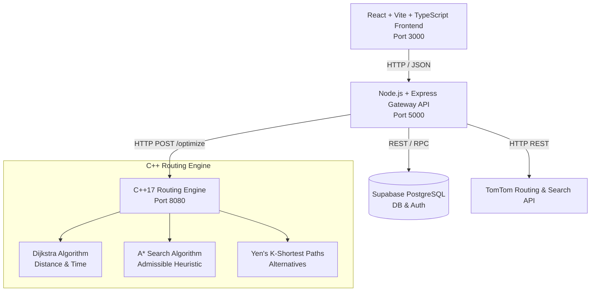

# Traffic Route Optimization using Graph Algorithms 🚦🗺️

A full-stack, production-grade college project demonstration proving the core message: **Shortest Route ≠ Always Best Route**.

Built with a high-performance **C++17 Graph Routing Engine**, **Node.js Gateway API**, **React + Vite + TypeScript Frontend**, and **Supabase Database**.

---

## 🌟 Key Features

- **Google Maps Style Route Selection**: Shows active Best Route (thick BLUE line), candidate Alternative Routes (clickable grey lines), and Shortest Distance Route (grey dashed line with badge).
- **Core C++ Graph Engine**: Custom implementations of **Dijkstra**, **A* Search** (with admissible Haversine heuristic), and **Yen's K-Shortest Paths** ($K=3$).
- **Multi-Objective Cost Formula**: Dynamic weight scoring incorporating distance, travel time, traffic congestion penalties, and vehicle road suitability.
- **3 Transport Modes**:
  - 🚶 **Walking**: Avoids motorways & highways.
  - 🚗 **Car**: Optimizes for distance, travel time, and congestion.
  - 🚚 **Heavy Vehicle**: Restricts non-truck roads ($\text{truck\_allowed} = \text{false} \implies \infty$) and penalizes narrow residential lanes.
- **Interactive Map**: Built with Leaflet, custom markers, traffic colors segment toggle, TomTom traffic flow layer, auto-fit bounds, and live 2-minute traffic refresh.
- **Dashboard & Analytics**: Recharts visualizations for traffic distribution, transport mode usage, and persistent search history.

---

## 🏗️ System Architecture



---

## 🧮 Mathematical Cost Formula

The decision for the optimal path is made by our C++ graph engine using:

$$\text{Cost}(e) = \alpha \cdot \text{NormDistance}(e) + \beta \cdot \text{NormTime}(e) + \gamma \cdot \text{TrafficPenalty}(e) \cdot \text{NormDistance}(e) + \delta \cdot \text{RoadPenalty}(e, m)$$

Where:
- $\text{NormDistance}(e) = \text{length\_m} / 1000.0$ (km)
- $\text{NormTime}(e) = \text{travel\_time\_s} / 60.0$ (min)
- $\text{TrafficPenalty}$: Low ($1.0$), Moderate ($2.0$), High ($4.0$), Severe ($7.0$)
- $\text{RoadPenalty}$: Penalizes unsuitable road types based on transport mode $m$.

---

## 🛠️ Project Structure

```
/traffic
├── /engine            # C++17 routing engine (CMake / build.bat, cpp-httplib, nlohmann/json)
│   ├── /config        # weights.json
│   ├── /src           # Node.h, Edge.h, Graph.h/cpp, WeightCalculator.h/cpp, Router.h/cpp, Server.cpp
│   ├── /tests         # test_engine.cpp (Unit tests)
│   └── CMakeLists.txt
├── /gateway           # Node.js + Express + TypeScript API layer (port 5000)
│   └── /src           # tomtom.service, graph_builder, cpp_engine.service, supabase.service, route.routes
├── /frontend          # React + Vite + TypeScript UI (port 3000)
│   └── /src           # MapView, SearchCard, RouteDetailsPanel, CompareModesView, AlgorithmView
├── /supabase          # schema.sql (Database tables, indexes, RLS, RPCs)
├── /docs              # algorithm.md, architecture.md
├── docker-compose.yml # Orchestrates all 3 services
├── .env.example
└── README.md
```

---

## 🚀 Quick Start & Setup

### Option 1: Running with Docker Compose (Recommended)

1. Clone repository and create `.env` file:
   ```bash
   cp .env.example .env
   ```
2. Add your TomTom API key and Supabase credentials to `.env`:
   ```env
   TOMTOM_API_KEY=your_tomtom_key
   VITE_TOMTOM_MAP_KEY=your_tomtom_key
   SUPABASE_URL=https://your-project.supabase.co
   SUPABASE_ANON_KEY=your_supabase_anon_key
   ENGINE_URL=http://engine:8080
   ```
3. Launch all 3 services:
   ```bash
   docker compose up --build
   ```
4. Access app in browser: `http://localhost:3000`

---

### Option 2: Running Locally Without Docker

#### Step 1: Build & Run C++ Engine (Port 8080)

Using GCC / MinGW:
```bash
cd engine
build.bat
test_engine.exe       # Runs unit tests
routing_engine.exe 8080
```
Or using CMake:
```bash
cd engine
mkdir build && cd build
cmake ..
make -j4
./test_engine         # Runs unit tests
./routing_engine 8080
```

#### Step 2: Start Gateway API (Port 5000)

```bash
cd gateway
npm install
npm run dev
```

#### Step 3: Start Frontend React App (Port 3000)

```bash
cd frontend
npm install
npm run dev
```

Open `http://localhost:3000` in your browser.

---

## 📡 Gateway API Reference

| Method | Endpoint | Description |
|---|---|---|
| `POST` | `/api/route` | Calculates optimal, shortest, fastest, and alternative routes for From/To |
| `POST` | `/api/compare-modes` | Evaluates route metrics across Walking, Car, and Heavy Vehicle in parallel |
| `GET` | `/api/autocomplete` | Location autocomplete suggestions |
| `GET` | `/api/history` | Retrieves past search history |
| `POST` | `/api/routes/:id/save` | Toggles saved/favorite status of a route search |
| `DELETE` | `/api/history/:id` | Deletes a search history record |
| `GET` | `/api/stats` | Aggregate dashboard analytics metrics |
| `GET` | `/api/health` | Health check for gateway, C++ engine, and external services |

---

## 🎭 College Demo Script (Hyderabad Case Study)

1. Open `http://localhost:3000` in browser.
2. Enter:
   - **From**: `Charminar, Hyderabad`
   - **To**: `HITEC City, Hyderabad`
3. Click **"Find Best Route"**.
4. **Observe Map & Results**:
   - The **Shortest Route** (grey dashed line) goes directly through Old City & Mehdipatnam ($\approx 16.5\text{ km}, 52\text{ min}$) with **Severe Congestion** 🔴.
   - The **Best Route** (thick BLUE line) takes the Outer Bypass ($\approx 18.2\text{ km}, 34\text{ min}$) with **Low Traffic** 🟢.
   - Reason badge explains: `Best route selected: cost 8.4 vs 14.2. +1.7 km longer but 18 min faster than shortest route.`
5. Click **"Compare Modes"** tab to view side-by-side metrics table for Walking, Car, and Heavy Truck.
6. Click **"Algorithm"** tab to view live Dijkstra vs A* execution time ($\mu\text{s}$) and adjust $\alpha, \beta, \gamma, \delta$ sliders!

---

## ⚠️ Limitations & Scope
- Graph construction builds road networks dynamically from TomTom candidate polylines.
- Height and weight restriction warnings for heavy vehicles are evaluated against simplified road classifications.
